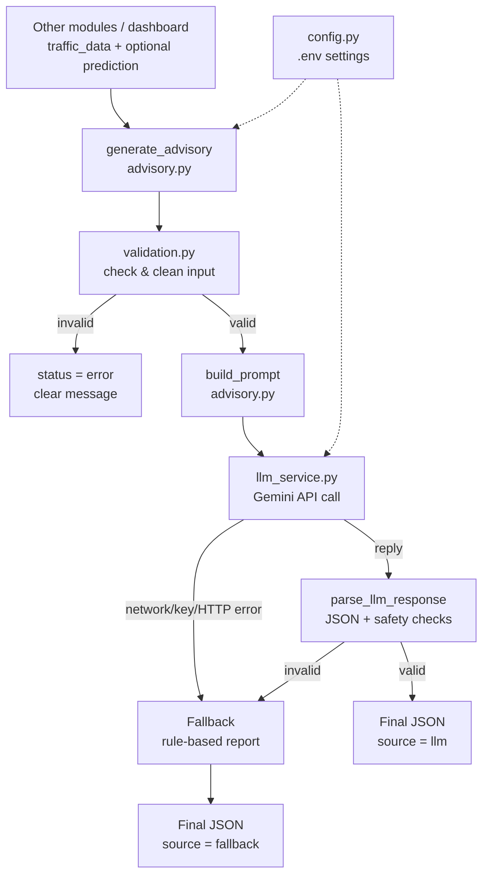

# TrafficVision – AI Traffic Advisory Module (Member 5)

## 1. Project overview
TrafficVision is a real-time traffic monitoring and prediction system (YOLO detection, tracking/counting, congestion classification, volume prediction, Streamlit dashboard, LLM advisory). This folder is the **sixth feature**: an LLM-powered advisory module.

## 2. My module's responsibility
Take vehicle counts + congestion level (+ optional prediction) and return a structured report: observation, advisory, recommended actions (suggestions for human review), prediction summary and priority. It works on its own with sample data and keeps working (rule-based fallback) when the LLM is unavailable.

## 3. Technologies
Python 3 · Google Gemini API (via standard-library `urllib`) · `python-dotenv` · `pytest`.
**Why Gemini?** Free tier through Google AI Studio (good for students), simple REST API with a JSON-output mode, no SDK required. All provider code is in `llm_service.py`, so it can be swapped without touching anything else. *Check Google AI Studio for currently available model names and free-tier limits; set the model in `.env`.*

## 4. Architecture

Key decision: **congestion and priority come from code, never from the LLM** (Free→Low, Moderate→Medium, Heavy→High). The LLM only writes wording, and every reply is checked before use.

## 5. Folder structure and purpose of each file
```text
traffic_advisory/
├── main.py             Command-line demo (samples, --offline, --input files)
├── advisory.py         Core logic: generate_advisory(), prompt, reply checks, fallback
├── llm_service.py      ONLY file that talks to Gemini; raises LLMServiceError on any problem
├── validation.py       Input checks (missing, negative, non-numeric, bad congestion, prediction)
├── config.py           Loads .env; priority mapping; API settings
├── sample_data.py      Illustrative sample inputs (not real measurements)
├── requirements.txt    python-dotenv, pytest
├── .env.example        Template for your secrets (copy to .env)
├── .gitignore          Keeps .env out of Git
├── tests/
│   ├── test_advisory.py   32 pytest tests (13 required scenarios + extras)
│   ├── scenarios.py       The 13 scenarios (shared data + fake LLM replies)
│   ├── run_scenarios.py   Runs scenarios and writes docs/TESTING_REPORT.md
│   └── conftest.py        Lets tests import project files
├── examples/
│   ├── call_from_other_module.py   How a teammate calls my function (tested)
│   └── streamlit_example.py        Dashboard display sample (NOT executed/tested)
└── docs/
    ├── PROMPT_DOCUMENTATION.md
    ├── TESTING_REPORT.md           (generated from a real run)
    ├── RESPONSIBLE_AI.md
    └── PRESENTATION_NOTES.md
```
**How files communicate:** `main.py`/dashboard → `advisory.generate_advisory()` → `validation` → `llm_service` (via `advisory`) → back to `advisory` → result dict. `config` is read by `llm_service` and `advisory`.

## 6. Installation (Windows, Command Prompt)
```bat
cd traffic_advisory
py -m venv venv
venv\Scripts\activate
pip install -r requirements.txt
```
(PowerShell: if activation is blocked, run `Set-ExecutionPolicy -Scope Process RemoteSigned` first.)

## 7. Environment variables (API key, securely)
1. Get a free key from Google AI Studio (aistudio.google.com).
2. `copy .env.example .env`
3. `notepad .env` → replace `your_api_key_here` with your key. Save.
4. Never share `.env`, never paste the key in code/chat/screenshots. `.gitignore` already excludes it. If a key leaks, delete it in AI Studio and create a new one.

## 8. Run
```bat
python main.py                      :: all 5 sample scenarios
python main.py --scenario rising    :: free | moderate | heavy | rising | easing
python main.py --offline            :: fallback only (no API needed)
python main.py --input my.json --prediction pred.json
python examples\call_from_other_module.py
```
Without a key, you still get a full report with `"source": "fallback"` and a `note` explaining why.

## 9. Run tests
```bat
python -m pytest -v
python tests\run_scenarios.py       :: regenerates docs\TESTING_REPORT.md
```

## 10. Input and output
**Input** (`traffic_data`; all five fields required; counts are whole numbers ≥ 0; congestion is Free/Moderate/Heavy, case-insensitive):
```json
{"cars": 120, "buses": 20, "trucks": 10, "two_wheelers": 80, "congestion": "Heavy"}
```
**Optional `prediction_data`** (`predicted_congestion` required if supplied; the other two optional; if `current_congestion` is given it must match `traffic_data["congestion"]`):
```json
{"current_congestion": "Moderate", "predicted_congestion": "Heavy", "predicted_vehicle_count": 280}
```
**Output** (real output from `python main.py --scenario rising --offline`):
```json
{
  "congestion": "Moderate",
  "priority": "Medium",
  "traffic_observation": "112 vehicles were reported in total (cars: 60, buses: 8, trucks: 4, two-wheelers: 40). Current congestion is classified as Moderate.",
  "advisory": "Moderate congestion has been detected. Traffic authorities may review signal timings and continue monitoring the junction. Traffic volume may increase, so authorities should consider preparing additional monitoring arrangements.",
  "recommended_actions": ["Review whether signal timing adjustments are appropriate.", "Monitor vehicle accumulation at the junction.", "Consider communicating alternative routes if congestion increases.", "Consider preparing additional monitoring arrangements ahead of the predicted increase."],
  "prediction_summary": "Congestion is predicted to change from Moderate to Heavy; traffic volume may increase. The predicted vehicle count is 280.",
  "status": "success",
  "source": "fallback",
  "note": "Fallback used: LLM disabled (offline mode)."
}
```
Two fields were added to your required format: `source` (`"llm"` or `"fallback"`) and `note` (reason for fallback/error, else `null`). `status` is `"success"` (also in fallback mode, since the report is usable) or `"error"` (invalid input; `note` lists every problem; other fields are null/empty).
`prediction_summary` is `null` when no prediction is supplied (enforced in code even if the LLM returns one).

## 11. Dashboard integration
```python
from advisory import generate_advisory
report = generate_advisory(traffic_dict, prediction_dict_or_None)
```
Teammates need only: put this folder on their path, `pip install python-dotenv`, and call the function. Suggested display: priority as coloured banner (`st.success/warning/error` for Low/Medium/High), then observation, advisory, bullet list of actions, prediction summary if not null, and a caption when `source == "fallback"`. Full sample: `examples/streamlit_example.py` (not executed in my testing; I have no Streamlit/teammate code to test against). Tip: cache results in the dashboard (e.g. only regenerate when congestion changes) to save API quota.

## 12. Limitations
- LLM text can be wrong, vague or inconsistent; checks catch format problems and some invented events but not every inaccuracy.
- Advice is based only on counts and congestion label: no road layout, signals, incidents, weather or time of day.
- The banned-word check is simple (it may reject harmless replies, which then use the fallback).
- Free API tiers have rate limits; response time is network-dependent.
- Automated tests use a fake LLM; the real Gemini call was not verified in my environment (see Testing Report).
- Suggestions only; not for automatic signal control.

## 13. Future improvements
Cache/rate-limit LLM calls, add junction name/time as optional input, add Hindi/Tamil output, log reports (without personal data) for review, richer prediction trends, a second provider behind the same `generate_text` interface.
